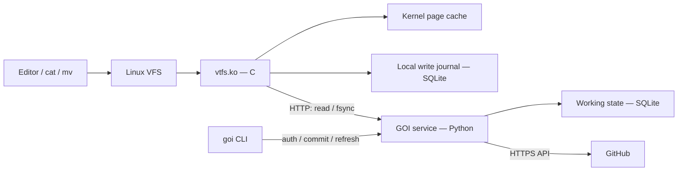

# GOI

**GitHub repositories as a Linux filesystem.**

Browse repositories as directories, edit files with your usual tools, and publish
changes with `goi commit`. GOI combines a Linux kernel module written in C with
a Python storage service and command-line interface.

> This repository currently contains the project overview. The implementation
> is available in [os-course](https://github.com/TheGeniusOfEternity/os-course/tree/lab-vtfs/lab/vtfs).
> GOI began as a VTFS operating systems lab and is being prepared as a standalone project.

## Features

- **Browser authentication** through GitHub OAuth Device Flow.
- **Lazy loading:** activate a repository explicitly, then fetch directory
  listings and file contents as they are accessed.
- **Branches as directories**, with users and organizations at the same level.
- **Regular filesystem operations:** read, write, create, delete, and rename files.
- **Separate saving and publishing:** `fsync` and autosync save working changes
  to the service; `goi commit` publishes selected changes as one GitHub commit.
- **Conflict handling:** three-way text merging and separate conflict files
  that preserve the working file until resolution.
- **Local recovery:** a persistent client write journal and recovery of
  interrupted GitHub publications.
- **Bounded caches**, ignore rules, change inspection, and restore commands.
- **Background operation** through a per-user systemd service.

## Architecture



With journaling enabled, a successful write is recorded in the local client
journal. `fsync` transfers the file to the main service, which stores working
state in SQLite. Publishing to GitHub is a separate, explicit operation.

The service can run locally in the background or on another machine. Each user
can run an independent local instance with their own database and authentication.

## Filesystem layout

```text
~/github/
├── your-login/
│   └── example-repo/
│       ├── .info.json
│       ├── main/
│       │   ├── README.md
│       │   └── src/
│       └── feature%2Fexample/
└── your-organization/
    └── another-repo/
```

Branch names containing slashes are encoded, for example
`feature/example` becomes `feature%2Fexample`.

## Try the current implementation

The verified environment is Ubuntu ARM64 with Linux **7.0.0-43-generic**
and Python **3.14**. Python components require Python 3.10+ and use the standard
library. Building the kernel module requires GCC, make, and matching kernel
headers. Other kernel versions may require VFS API changes.

Use a dedicated Linux VM for kernel module testing.

```bash
git clone --branch lab-vtfs https://github.com/TheGeniusOfEternity/os-course.git
cd os-course/lab/vtfs

make W=1
export PATH="$PWD/bin:$PATH"
source "$PWD/shell/goi.sh"
sudo insmod source/vtfs.ko
```

Create a GitHub OAuth App, enable **Device Flow**, and obtain its Client ID.
A client secret is not required for this authentication flow.

```bash
# One-time local service setup:
goi service install --client-id YOUR_CLIENT_ID

# Mount starts the local service if needed:
goi mount ~/github
goi auth ~/github

# Use an existing repository with at least one commit:
goi activate ~/github/YOUR_LOGIN/YOUR_REPO
cd ~/github/YOUR_LOGIN/YOUR_REPO/main

cat README.md
printf '\nHello from GOI\n' >> README.md
goi status
goi diff
goi commit README.md -m "Update README"
```

Replace the login, repository, and branch with your own values.
`goida` is shorthand for `goi commit`. Without explicit paths, commit selects
all non-ignored pending changes in the branch.

When finished:

```bash
cd ~
goi unmount ~/github
```

## Background service

```bash
goi service status
goi service restart
journalctl --user -u goi -f
```

The user service starts at login and restarts after failure. Its default data
directory is `~/.local/share/goi`. The unit stores the absolute checkout path;
after moving the source directory, repeat installation with the Client ID and
restart the service.

To use a manually managed or remote backend, pass its address and session token:

```bash
goi mount ~/github --server http://127.0.0.1:8080 \
  --token-file /path/to/server-token
```

These settings are saved for subsequent mounts. Remote connections require a
trusted network or an SSH tunnel: the kernel-to-service protocol uses HTTP.

## Testing

From the current implementation directory:

```bash
make test
make W=1
```

The suite contains **68 Python tests** using a controlled GitHub API fixture.
Kernel integration tests run separately in a compatible VM. The ARM64 QEMU
runner also supports a crash-and-recovery scenario with a persistent virtual disk.

## Current limitations

- Experimental kernel module; compatibility across Linux versions is not guaranteed.
- One writer per working state; the service does not provide isolated workspaces
  for multiple simultaneous users.
- Maximum file size: 64 MiB.
- No complete offline mode: directory operations require the main service.
- Creating branches and publishing the first commit of an empty repository
  are not supported yet.
- Ordinary Git commands inside the mount are blocked; use GOI commands.
- Reopen working files after refresh, restore, or conflict resolution.
- The page-cache quota does not include metadata or temporary buffers.

## Background and documentation

GOI originated in the VTFS lab of the
[os-course repository](https://github.com/TheGeniusOfEternity/os-course).
The original template attribution and SPDX notices are retained in the source.

The existing technical documentation is in Russian; new project documentation
will be maintained in English.

- [Setup and command reference](https://github.com/TheGeniusOfEternity/os-course/blob/lab-vtfs/lab/vtfs/DEVELOPMENT.md)
- [From mount to commit](https://github.com/TheGeniusOfEternity/os-course/blob/lab-vtfs/lab/vtfs/WALKTHROUGH.md)
- [HTTP protocol](https://github.com/TheGeniusOfEternity/os-course/blob/lab-vtfs/lab/vtfs/PROTOCOL.md)
- [Interactive architecture guide](https://github.com/TheGeniusOfEternity/os-course/blob/lab-vtfs/lab/vtfs/docs/goi-guide.html)
