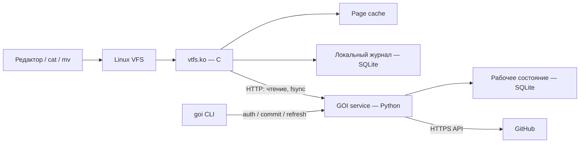

# GOI

**GitHub как файловая система Linux.** Открывай репозитории обычным редактором,
сохраняй файлы и публикуй изменения командой `goi commit`.

GOI — экспериментальный проект: модуль ядра Linux на C, локальный или удалённый
сервис на Python и CLI. Сервис хранит рабочее состояние в SQLite и общается с
GitHub API. Сторонние Python-библиотеки не нужны.

## Возможности

- Авторизация в браузере через GitHub Device Flow.
- Пользователи и организации на одном уровне, репозитории и ветки как каталоги.
- Явная активация репозитория; файлы скачиваются по мере обращения.
- Чтение, запись, создание, удаление и переименование через обычные файловые операции.
- `fsync` и autosync сохраняют изменения на сервисе; `goi commit` публикует
  выбранные файлы одним GitHub-коммитом.
- Трёхстороннее слияние, отдельные конфликтные копии, restore и refresh.
- Клиентский журнал на диске, восстановление незавершённой публикации, ограничение кеша.
- `.goiignore`, просмотр изменений, переключение веток через shell-интеграцию.
- Фоновый локальный сервис через пользовательский systemd.

## Как устроено



Успешная запись подтверждается клиентским журналом. `fsync` переносит её в
основной сервис. Публикация на GitHub происходит отдельно, через `goi commit`.
У каждого пользователя на своей машине может работать собственный сервис
с отдельной базой и авторизацией.

Пример дерева:

```text
~/github/
├── your-login/
│   └── example-repo/
│       ├── .info.json
│       ├── main/
│       │   ├── README.md
│       │   └── src/
│       └── feature%2Fexample/
└── your-organization/
    └── another-repo/
```

## Быстрый старт

Проверенная среда: Ubuntu ARM64, Linux **7.0.0-43-generic**, Python **3.14**.
Python-компоненты требуют Python 3.10+. Для сборки нужны GCC, make и заголовки
ядра. VFS API зависит от версии Linux: для другого ядра может понадобиться
адаптация. Запускайте модуль в отдельной VM.

```bash
git clone https://github.com/TheGeniusOfEternity/goi.git
cd goi
make W=1
export PATH="$PWD/bin:$PATH"
source "$PWD/shell/goi.sh"
sudo insmod source/vtfs.ko
```

В GitHub создайте OAuth App, включите **Enable Device Flow**, возьмите Client ID.
Client secret для Device Flow не нужен.

```bash
# Один раз:
goi service install --client-id YOUR_CLIENT_ID

# Mount сам запускает локальный сервер:
goi mount ~/github
goi auth ~/github

goi activate ~/github/YOUR_LOGIN/YOUR_REPO
cd ~/github/YOUR_LOGIN/YOUR_REPO/main
cat README.md
```

Вместо YOUR_LOGIN/YOUR_REPO укажите свой тестовый репозиторий с хотя бы одним
коммитом. Путь точки монтирования произвольный.

```bash
printf '\nHello from GOI\n' >> README.md
goi status
goi diff
goi commit README.md -m "Update README"

cd ~
goi unmount ~/github
```

`goida` — короткая форма `goi commit`. Без списка путей публикуются все
неигнорируемые изменения ветки. До авторизации просмотр корня запрещён.

## Фоновый сервис

```bash
goi service status
goi service restart
journalctl --user -u goi -f
```

Unit запускается при входе пользователя и перезапускается после аварии.
Данные по умолчанию находятся в `~/.local/share/goi`.
Unit хранит абсолютный путь к checkout: после перемещения проекта повторите
`goi service install --client-id YOUR_CLIENT_ID` и перезапустите сервис.

Удалённый или вручную запущенный сервер задаётся явно:

```bash
goi mount ~/github --server http://127.0.0.1:8080 \
  --token-file /path/to/server-token
```

Эти настройки сохраняются для следующих mount. Для удалённого сервера используйте
доверенную сеть или SSH-туннель: транспорт между ядром и сервисом — HTTP.
Основной сервис рассчитан на одного писателя рабочего состояния, а не на
изолированные рабочие пространства нескольких пользователей.

## Документация

- [Подробный запуск и команды](DEVELOPMENT.md)
- [Путь файла от mount до commit](WALKTHROUGH.md)
- [Интерактивный конспект](docs/goi-guide.html) — скачать и открыть в браузере
- [HTTP-протокол](PROTOCOL.md)
- [Разработка и тесты](CONTRIBUTING.md)
- [История изменений](CHANGELOG.md)
- [Происхождение исходников и лицензирование](NOTICE.md)

## Проверки и ограничения

```bash
make test
make W=1
```

В наборе 68 Python-тестов с подставным GitHub API. Для проверки модуля есть
`test/run-vm-tests.sh` и ARM64 QEMU runner `test/run_qemu.py`, включая
сценарий восстановления после аварии. Подробности — в DEVELOPMENT.md.
CI запускает Python-тесты; модуль требует отдельной совместимой VM.

Файл ограничен 64 МиБ. Полного offline-режима, создания веток и первого коммита
пустого репозитория пока нет. Обычный Git внутри GOI блокируется: используйте CLI GOI.
После refresh/restore/resolve рабочие файлы нужно переоткрывать.
Квота page cache не включает метаданные и временные буферы.

Проект вырос из лабораторной VTFS; исходная учебная версия остаётся в
[os-course](https://github.com/TheGeniusOfEternity/os-course/tree/lab-vtfs/lab/vtfs).
